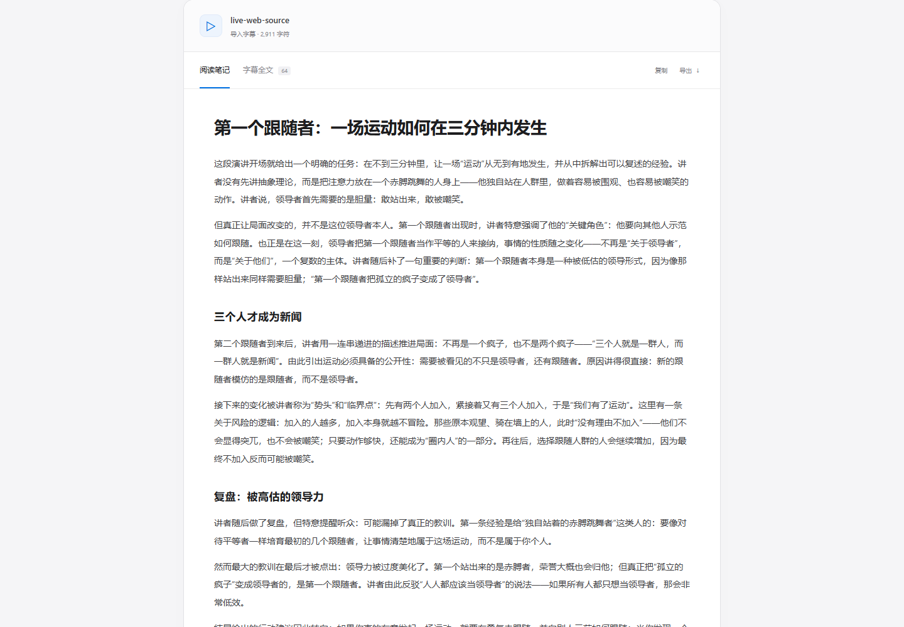

# readvideo

**把视频，读成文章。**

[中文网站](https://survivorno1.github.io/readvideo/) · [English website](https://survivorno1.github.io/readvideo/en.html) · [English README](README.en.md)

输入视频链接，用 [yt-dlp](https://github.com/yt-dlp/yt-dlp) 提取已有字幕，再用你自己的 API 生成速读摘要或完整文章。一个页面，白灰界面，不需要账号，不下载视频。


## 使用

需要 Python 3.10 或更新版本。Windows 可以双击 `run.bat`。也可以手动启动：

```sh
git clone https://github.com/SurvivorNo1/readvideo.git
cd readvideo
python -m venv .venv
# Windows
.venv\Scripts\python -m pip install -r requirements.txt
.venv\Scripts\python app.py --open-browser
# macOS / Linux
# .venv/bin/python -m pip install -r requirements.txt
# .venv/bin/python app.py --open-browser
```

默认地址：[http://127.0.0.1:4174](http://127.0.0.1:4174)。服务只监听本机，关闭终端即停止服务。它有 Python 后端，不能把网页文件单独放到 GitHub Pages 当成可工作的字幕服务。

1. 点右上角 **API 配置**，选服务商、填 Key，测试连接后保存。
2. 粘贴视频链接，选择 **速读摘要** 或 **完整文章**；文章可选 **短篇／中篇／长篇／详细**，点 **提取并生成**。
3. 在文章和原字幕间切换，点击时间点回看原视频；复制或导出 Markdown。

## 完整字幕与文章校订

**原字幕**保留所选字幕轨道的所有可读取内容和时间点。搜索仅筛选显示，复制与导出始终包含完整字幕。仅提取字幕不需要模型 Key；这不等于获取所有语言轨道，也不包含无字幕视频的语音转写。超出处理上限会明确报错，不会悄悄截断。

| 文章篇幅 | 中文目标 | 英文目标 | 整理重点 |
| --- | --- | --- | --- |
| 短篇 | 300–500 字 | 200–350 words | 核心结论 |
| 中篇 | 800–1,500 字 | 600–1,000 words | 主要观点与论据 |
| 长篇 | 1,800–3,000 字 | 1,200–2,000 words | 例子与推理过程 |
| 详细 | 3,000–5,000 字 | 2,000–3,500 words | 关键过程、证据与限制 |

篇幅是提示词目标，不强制凑字数。素材不足时要求模型缩短并说明。提示词围绕视频实际主题组织文章，校订上下文能确定的明显转写错误、断句和表达；数字、单位、否定与引语归属不能凭猜测修改。存疑的人名、术语或事实保留并标注，重要校订附简短说明，原字幕不被改写。模型可能误判，且应用没有外部事实核查功能。

中英文 GitHub Pages 是产品展示与安装入口。应用界面当前为中文，生成内容可在高级设置选择中文或英文。

只想读字幕时，点 **仅提取字幕**，不需要 API Key。平台无法访问或视频没有字幕时，也可以导入 SRT/VTT/JSON 字幕，再根据字幕生成。

## API 配置

| 服务 | 默认接口与模型 | 说明 |
| --- | --- | --- |
| DeepSeek | `https://api.deepseek.com` · `deepseek-flash` | 使用自己的 Key，按账户实际用量计费 |
| Gemini | Google 官方 OpenAI 兼容接口 · `gemini-3.8-flash` | 可使用符合条件的免费额度，地区、资格与限额由 Google 决定 |
| 自定义 API | 可编辑 Base URL 和模型名 | 兼容 HTTPS Chat Completions 的服务商或网关 |

地址、模型与输出语言放在高级设置里。选择预设通常只需填 Key，不需要修改接口。

Key 只存在当前页面和处理请求的后端内存里，不写入 localStorage、配置文件、日志或导出文章。刷新页面后需要重新填写。保存到浏览器的只有服务地址、模型和语言偏好。

开发时可运行 `python app.py --read-key`，通过不回显的终端输入，把 DeepSeek 调试 Key 只载入后端内存。这个 Key 不会回传给网页，也只能发往 DeepSeek 官方地址；自定义地址需要自己的 Key。仓库不包含任何真实凭据。

官方依据：[DeepSeek 模型与接口](https://api-docs.deepseek.com/quick_start/pricing/)、[Gemini 兼容接口](https://ai.google.dev/gemini-api/docs/openai/)、[Gemini 免费额度说明](https://ai.google.dev/gemini-api/docs/pricing)。

## 做了什么

- 读取视频信息及可用字幕，优先匹配选择的语言，再优先人工字幕。
- 使用 yt-dlp 的原生字幕下载器，处理普通字幕及 HLS 分段字幕的合并与时间对齐。
- 清理滚动字幕的相邻重复，保留原始时间点；支持 VTT、SRT、YouTube JSON3、Bilibili JSON。
- 长字幕分段阅读，再整合全文，不悄悄截断后半段。长内容可能产生多次 API 调用。
- 摘要和文章基于字幕，不宣称看过画面；网页按文本安全呈现模型输出。
- 导出来源链接、时间点和内容，不包含 API Key。



## 已知边界

yt-dlp 支持的站点不等于所有视频都有可读取字幕。视频可能没有字幕、需要登录、受地区限制，或触发站点限流。应用不会自动读取浏览器账号或绕过付费限制。本版本不下载音频做语音转写。

YouTube 等站点可能还需要 yt-dlp 支持的 JavaScript 运行时；推荐安装 Node 20 或更新版本，并保持 yt-dlp 更新。平台变化时可在虚拟环境中运行 `python -m pip install -U "yt-dlp[default]"`。

输入字幕会在你请求生成时发送给所选模型服务商。自动字幕及模型整理都可能出错，请用原视频核对关键事实。本应用是本机单用户工具，不作为公网多用户服务部署。

字幕导入上限为 3 MB；解析后的文本上限为 30 万字符；单次生成最多处理 32 个分段。超出限制会明确报错，不产生伪装完整的部分结果。

## SDD + TDD

行为先写在 [SPEC.md](SPEC.md)，对应验收过程见 [开发与验证记录](docs/verification.md)。

```sh
python -m unittest discover -s tests -v
# 可复现的浏览器验收（使用明确标注的测试夹具，不计作真实模型验证）
npm ci
npx playwright install chromium
npm run test:browser
```

当前有 **36 项 Python 测试、12 个浏览器场景**。真实视频提取和真实 API 调用是单独的手动/显式验证，不混进确定性测试结果，也不把测试夹具包装成真实生成。

MIT 开源。本项目独立于 yt-dlp，使用其公开 Python 能力并保留上游链接；yt-dlp 及其依赖保留各自许可证。
