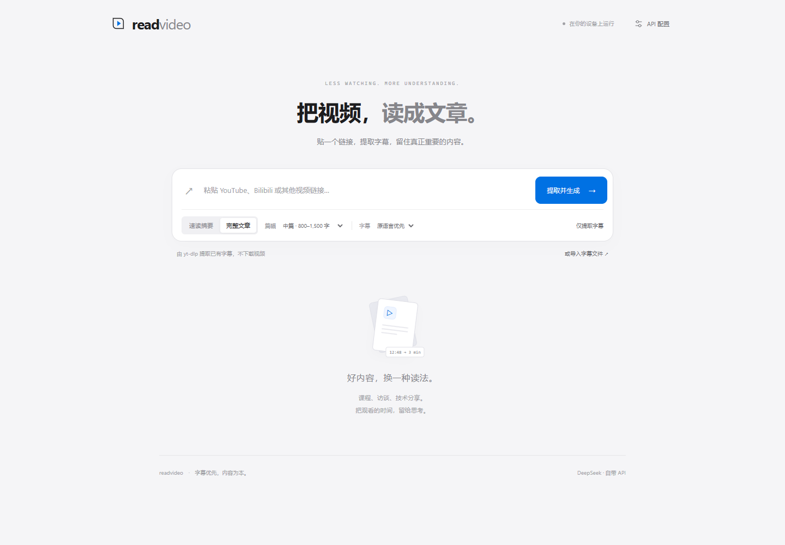
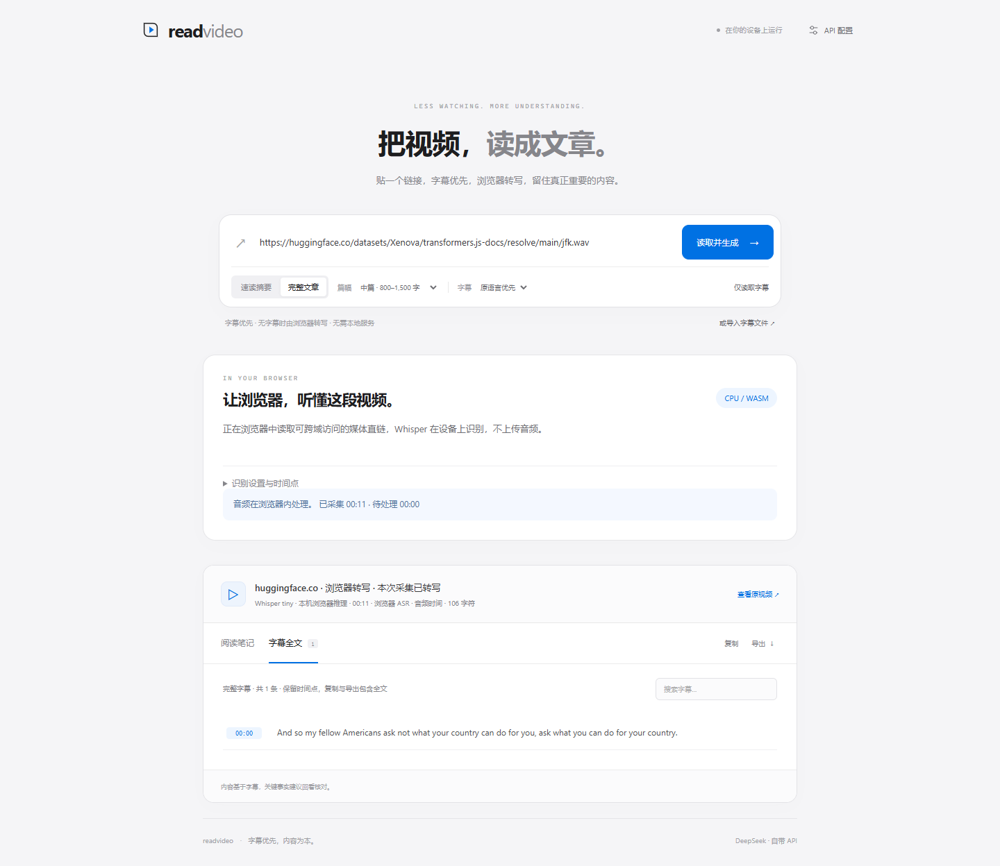

# readvideo

**把视频，读成文章。纯前端，无需本地服务。**

[立即使用](https://survivorno1.github.io/readvideo/app/) · [中文介绍](https://survivorno1.github.io/readvideo/) · [English](README.en.md)



保留简洁的单页界面：粘贴链接，优先读取可访问的字幕；无法读取时，用户授权视频标签页音频，由浏览器 Whisper 转写，再用自己的模型 API 生成文章。不需要 Python、yt-dlp、扩展或本地模型服务。

## 使用

1. 打开在线应用，在右上角配置 DeepSeek、Gemini 或兼容 API。仅读取字幕和转写不需要模型 Key。
2. 粘贴链接，选择速读摘要，或短篇／中篇／长篇／详细文章，点击「读取并生成」。
3. 可跨域读取的字幕直接整理成文章，跳过 ASR。支持的 YouTube、Bilibili 链接优先显示本页播放器：先点击「授权本页音频并转写」，选择当前 readvideo 标签页并勾选音频，再播放视频。若内嵌受限，点击「原站播放」，改为共享原视频标签页音频。
4. 从起点播放；页面边采集边识别。播放结束后点击「停止采集，完成转写」，处理完队列后自动整理文章。
5. 查看、搜索、复制、导出全文。搜索只筛选显示，导出包含所有已获取字幕。

## 浏览器加速与无 GPU 支持

- 自动选择读取路径：字幕优先；可读取的页面里若有完整音轨，直接下载并在本机转写，无需等待播放；否则提供标签页音频授权。平台有字幕不代表普通网页有读取权限。
- 同一链接、同一识别语言的已完成字幕可以复用。换短篇、中篇、长篇或详细文章时，无需重新播放、识别。
- Transformers.js 3.8.1 和 Whisper tiny 多语言量化模型在 Worker 内运行。首次按需下载代码与模型，后续复用浏览器缓存。
- 优先尝试 WebGPU；GPU 初始化或识别失败，保留同一段音频并切换 CPU。也可以手动选择 CPU/WASM，已用真实语音验证。
- AudioWorklet 采集、模型 Worker 推理、主线程界面分离；24 秒窗口配上下文，边播放边识别，停止后的尾段也会处理。
- 显示待处理时长；积压达到 20 分钟时停止继续采集并处理已有音频。识别失败保留队列和已识别文本，可用 CPU 重试或下载未处理音频 WAV。
- GitHub Pages 没有跨域隔离响应头，WASM 模型默认单线程。采用 UI／音频／推理分工和可选 GPU 加速，不无限创建模型实例。CPU 速度取决于设备，慢设备可能要等待队列。

## 篇幅与校订

| 篇幅 | 中文目标 | 英文目标 |
| --- | --- | --- |
| 短篇 | 300–500 字 | 200–350 words |
| 中篇 | 800–1,500 字 | 600–1,000 words |
| 长篇 | 1,800–3,000 字 | 1,200–2,000 words |
| 详细 | 3,000–5,000 字 | 2,000–3,500 words |

提示词围绕字幕的实际主题组织文章，校订上下文能确定的转写错误、断句和标点；保留数字、单位、否定、归因和限定条件。存疑的人名、术语和事实保留并标注，重要校订附说明。原字幕不改写，纠错不等于外部事实核查。篇幅是目标，素材不足时缩短，不凑字数或编造例子。长字幕分段处理，超限明确报错，不静默截断。

## 权限与边界

首版重点支持桌面 Chrome / Edge 的标签页音频共享。浏览器选择器由用户操作；应用不会替用户授权，也不会改用麦克风。

共享获得的是正在播放的音频，不是整段音轨下载权。转写受播放进度影响，跳过的内容无法补齐。时间点以采集时钟为基础，可设置视频起点；暂停、跳转、广告、倍速会影响回跳准确性。网页不能绕过平台的鉴权、CORS 或媒体保护。可跨域的媒体直链和 SRT/VTT/JSON 字幕导入也是可用入口。

音频留在设备浏览器，不上传 ASR 服务。生成文章时，字幕和 Key 由浏览器直接发给选定模型服务商。Key 仅在页面内存，不写 localStorage、文件或导出内容；刷新后需重新填写。自定义 API 必须允许浏览器 CORS；免费额度和地区由服务商决定，不内置共享 Key，不使用 Ollama。

界面当前为中文，文章支持中文和英文；产品介绍页有中英文版本。旧 Python 原型已移除，仅保留于 Git 历史。

## 真实验证

[YouTube / Bilibili 实测记录与 CPU 计时](docs/platform-evaluation.md)：明确标记已观察、受限和未验证的部分，不将音频授权入口当成整个平台流程通过。

Chrome 已在 CPU/WASM 模式下使用真实 Whisper 模型识别公开 JFK 语音样本；另以浏览器直接请求 DeepSeek，将 64 条字幕生成 1,472 字中文文章，无应用后端或代理。[验证记录](docs/verification.md)



确定性测试中的合成音频和模型适配器不作为真实模型或权限选择器证据。WebGPU 未作为本开发环境的真实验收路径；CPU 已真实验证。

## 开发

用户直接打开在线应用。贡献代码才需要 Node.js 24+：

```sh
npm ci
npm test
# 使用已安装的 Chrome；PowerShell：
# $env:READVIDEO_BROWSER_CHANNEL='chrome'
npm run test:browser
npm run dev
npm run build
```

开发服务器只提供静态文件。生产是 GitHub Pages 上的真实 `/app/` 应用。CI 测试通过后部署，打包采用明确文件白名单，不含录音、Key 或调试输出。

`npm run test:asr:live` 会显式下载真实模型和公开语音样本，不在常规 CI 自动运行。可选真实 API 测试需要授权 Key，并可能产生服务商费用。

[行为规格](SPEC.md) · [贡献指南](CONTRIBUTING.md) · [MIT](LICENSE)

使用 [Transformers.js](https://github.com/huggingface/transformers.js) 和 [Whisper tiny ONNX](https://huggingface.co/onnx-community/whisper-tiny)，依赖和模型遵循各自许可证。
