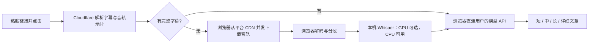

# readvideo：链接到文章的浏览器直连设计

状态：2026-10-25 线上主链路已打通。VPS 轻量解析服务上线，真实 Chrome 在 GitHub Pages 上完成「粘贴链接 → 解析 → 直连 CDN 下载 → 浏览器 ASR → 完整字幕」全流程（22 条字幕 / 1,852 字符）。Cloudflare Worker 仍因 412 不可用，已改为 VPS 解析。

## 2026-10-25 VPS 解析服务上线

### 结论

线上主链路已可用，不再是「仅本机验证」。

### 实测证据（真实 Chrome，访问 https://survivorno1.github.io/readvideo/app/）

| 环节 | 结果 |
|---|---|
| CORS 预检 | `OPTIONS /rv-resolve/resolve` → **204** |
| 解析 | `POST /rv-resolve/resolve` → **200**，返回标题、时长、音轨直链 |
| 音轨下载 | `GET upos-sz-mirrorcosov.bilivideo.com/...m4s` → **206 ×4**（4 路 Range 并发） |
| 解码 + 转写 | Whisper tiny @ WebGPU，`01:58` 音频 → **22 条字幕 / 1,852 字符** |
| 对照组 | 桥接页不带 `?r=` 时 CDN 返回 **403**，符合预期 |

样本 `BV1VS4y1t7st`（2:01，无字幕，走 ASR）。
截图：`readvideo-deploy/live-success.png`。

### 关键发现：B 站按 UA 做风控，且与直觉相反

在 VPS（洛杉矶出口）上实测：

```
Chrome UA + Referer            → HTTP 412  request was banned
Chrome UA + 完整浏览器头        → HTTP 412
curl UA                        → HTTP 200 ✅
Node 默认 UA                   → HTTP 200 ✅
空 UA（不发 User-Agent）        → HTTP 200 ✅
```

**因此解析服务请求 `api.bilibili.com` 时不能发 User-Agent。** 这与「伪装成浏览器更安全」的直觉相反，是本次能跑通的前提。同时**不能发 `Origin`**（B 站 API 有 Origin 白名单，带了直接 403）。

### 音轨地址过滤

平台返回的 `baseUrl` 常是 P2P CDN（`*.mountaintoys.cn:4483`，**带端口**），备份镜像是 `*.bilivideo.com`（**不带端口**）。前端 `audioURL()` 拒绝带端口的地址与非白名单域名，因此服务端只返回 `bilivideo.com` / `bilivideo.cn` 且不带端口的镜像。`audio-bridge.html` 的 CSP 也只放行这两个域，两边一致。

### 已知限制

- **地区限制**：VPS 在洛杉矶。少数视频（实测音乐 MV）对海外 IP 返回 `-404 啥都木有`，服务返回 404 并说明原因。国内出口可正常访问同一视频。
- **镜像数不稳定**：平台有时只返回 1 个合格镜像，此时无回退源。
- **无登录态**：不接收用户 Cookie，番剧/大会员内容不可解析。
- **不保证不被封**：UA 规则与 IP 段策略随时可能调整；熔断器只保护服务器，不保证解析成功率。

### 部署位置与回滚

- 代码：`/opt/readvideo`（独立用户 `readvideo`，systemd 限额 256 MB / 50% CPU / TasksMax 64）
- 路由：nginx `location /rv-resolve/` → `127.0.0.1:8891`，Caddy 与既有站点未改动
- 备份：`/root/backup-rv-<时间戳>/`
- 卸载：`server/deploy/99-uninstall.sh`
- 迁移说明见 `server/README.md`


## 本次实测进展

- 41 分 52 秒样本 `BV1QAnB67EL3`：真实 Chrome、生产下载模块、无媒体模拟，20,627,701 字节音轨下载 4,908 ms，解码 6,587 ms，解码时长 2,511.893 秒，共 105 个窗口。缓存再次读取 78 ms，完整文件 SHA-256 一致。
- 118 秒样本 `BV1VS4y1t7st`：真实 CPU Whisper 转写首次全流程 42,028 ms，5 次推理、26 条字幕；重试 2,384 ms，0 次新推理，字幕数和字符数一致。
- 上述解析地址来自本机 Node 测试准备，音轨由真实浏览器从 CDN 获取；不能据此宣称 Cloudflare 解析成功。未调用文章模型，长样本尚未进行完整 ASR，缓存测试不等于强制关闭浏览器后的恢复验收。
- [完整下载记录](evaluation-data/bilibili-direct-full.json)、[CPU 转写记录](evaluation-data/bilibili-direct-asr.json)。可复现命令：`node tests/direct-full-live.mjs`、`node tests/direct-asr-live.mjs`。它们需要网络和 Chrome，故不加入离线单元测试。
- 参考 [yt-dlp 的 Bilibili 提取实现](https://github.com/yt-dlp/yt-dlp/blob/master/yt_dlp/extractor/bilibili.py)核对独立音轨、字幕与 WBI 请求。Cloudflare 412 与浏览器下载速度分别验证，不用已有下载器的存在替代线上成功证据。

## 用户只做什么

首次填写自己的模型 API Key，此后粘贴视频链接，点击「读取并生成」。保持现有单页界面，不安装扩展，不打开开发者工具，不要求播放完整视频，不要求手动导入音轨。

有完整字幕时直接生成文章；没有可用字幕时，浏览器下载独立音轨、转写，再生成文章。没有 GPU 的设备使用 CPU。短、中、长、详细四档文章与基于内容的校订规则保留。

## 核心修正

**主路径改为解析服务只返回信息，浏览器直连平台 CDN 下载音频。** Cloudflare 不承担主路径的音轨流量、解码、ASR 或文章生成；个人服务器不进入链路。已有 Worker 音轨转发只作为可配置、有限额的备用通道。



### 解析服务

- 保留视频编号与分 P，过滤追踪参数。解析完整字幕列表、标题、时长、独立音频编码与码率、候选镜像、地址到期信息。
- 请求平台时构造自己的 UA 与 Referer，不转发浏览器的 Origin、Authorization 或 Cookie。公共 UGC 为首版范围。
- 优先返回字幕内容或可用字幕地址；其次返回 **直接 CDN 地址与镜像列表**，不能只返回 Worker `/media` 地址。
- 缓存以 `bvid + cid + part + language` 为键。先采用约 10 分钟的短缓存，并保留过期安全余量；不把所有签名地址都假定为固定两小时有效。
- 默认限流，失败时区分平台 HTTP 状态、平台业务错误、过期地址与无音轨。不要把解析失败静默变成「需要播放」。
- 不收集 SESSDATA，不共用维护者账号。API Key 只用于用户选定的文章模型服务。

当前 Cloudflare 的信息、签名与播放器请求仍需单独通过实网验收：已有 412 记录。浏览器直连解决了媒体传输路径，不能把本机解析成功写成 Cloudflare 解析已成功。`worker/index.mjs` 目前的出站请求本来就没有转发用户 Origin，因此不能把已有 412 简单归因为 Origin。

### 浏览器下载

- 在专门的下载 iframe 中采用已验证的页面 Referer 方法，示例路径为 `audio-bridge.html?r=https://www.bilibili.com`。用户无需修改地址或操作该 iframe。
- 主界面维持正常 Referrer Policy；只在下载上下文使用完整 Referer。桥接页地址不含 API Key、Cookie、用户输入原文或临时音轨地址。
- 桥接页不加载分析 SDK、广告或第三方脚本，不接收模型 Key。采用 sandbox 与受校验的消息通道；实现时必须单独测试其实际 Origin/CORS 行为，不能把顶层页面测试自动当作 sandbox 验收。
- 首先请求小范围字节，要求浏览器能通过 CORS 读取到 206 和正确的 Content-Range，再开始并发。默认 4 路，最多 6 路；下载加速不等于创建多个 ASR 模型。
- 根据内容长度按字节分块下载，验证每块的起止、长度、总长度及来源身份，按序组装。下载分块不等于可单独解码的音频分段。
- 优先适合语音识别的低码率音轨，不默认选择最高码率。候选镜像只做少量探测，避免为测速重复下载整段音频。
- 候选地址必须来自平台解析结果并通过 HTTPS 来源校验，首版优先支持 `bilivideo.com` / `bilivideo.cn` 的媒体域。不能因为平台返回了一个第三方镜像就自动允许任意域名，也不能让下载桥接页变成任意 URL 请求器。
- 超时或临时失败先重试缺块，再尝试同一音轨的镜像；若源不支持 Range，回退有大小上限的完整单流。200、错误 HTML 或不匹配的范围不能当成成功分片。
- 桥接直连失败才尝试启用的 Worker 转发，并明确显示当前使用的路径。转发有独立配额与大小上限，不能宣称「备用一定成功」。

真实 Chrome 已观察到：同一条 `BV1QAnB67EL3` 音轨，普通 readvideo 页面请求返回 403；使用提案的完整页面 Referer 后返回 206，CORS 可读到 1,024 字节，Content-Range 声明总长 20,627,701 字节。该样本时长 2,512 秒，即 41 分 52 秒。**这是下载前提验证，还不是完整下载或 ASR 计时。** [机器可读记录](evaluation-data/bilibili-direct-referrer.json)

### 解码与转写

首版采用「完整压缩音轨下载 → 解码 → 20–30 秒窗口推理」，复用现有 24 秒窗口、2 秒上下文和渐进出字。每完成一个窗口就更新字幕，文章生成必须等待完整字幕；识别失败不能标记完成。

全量解码需要独立内存门槛。当前 `web/source.mjs` 使用默认 AudioContext，可能先得到设备采样率的多声道 PCM，再转换成 16 kHz 单声道；**最终 PCM 大小不是实际峰值内存**。例如 2,512 秒的 16 kHz 单声道 float32 约 160.8 MB，而 48 kHz 双声道 float32 已约 964.6 MB，尚不含其他缓冲和模型。长视频实现应减少副本，优先验证 16 kHz 解码上下文或分段解码；移动设备不能只按 160 MB 估算。

后续的高速渐进解码采用 **MP4/M4A demux + WebCodecs AudioDecoder** 或可验证的兼容解码器，按真实采样时间送入 PCM 窗口，并提供背压。不能把普通字节 Range 当作独立 MP3/M4A 文件直接解码。

提案中的 MSE → HTMLMediaElement → AudioWorklet 仍然受媒体播放时钟约束；它可以低内存采集，但不能作为「无需等待播放、尽可能快」的主解码架构。要脱离播放速度，必须从压缩音频采样解码，而不是依赖播放元素输出。

GPU 初始化失败时使用 CPU/WASM，保留同一任务。首次模型下载与预热单独计时。Pages 当前没有跨域隔离，不承诺 WASM 多线程；一个模型 Worker 加 UI/下载分工是默认路径。tiny 先作为可用默认，其他模型须通过设备内存、速度与准确率实测后再开放。

### 中断恢复

IndexedDB 保存任务信息、完整性校验后的压缩音频块、已完成的时间窗口与字幕。API Key、登录 Cookie、模型请求头均不写入数据库。

任务身份使用 `platform + bvid + cid + part + recognition_language + model_revision + windowing_version`，并记录音轨的编码、码率、大小及内容指纹。**不以临时音频 URL 的哈希作为稳定任务身份**，因为 URL 会过期或更换镜像。

恢复时重新解析地址，确认音轨身份后复用已下载块和已完成窗口。强校验信息缺失或内容不一致时重新下载，不把不同音轨拼接在一起。不仅保存转写文字，也保留足以继续解码/转写的音频数据；数据库额度不足时明确提示。用户可清除任务与本地缓存。

### 用户看到的进度

一个界面内依次显示：解析、下载、解码、转写、整理文章。下载显示实际字节、速率和分片数；转写显示已处理时长、字幕与剩余窗口。ETA 根据本设备已完成窗口估计，并分别标记模型首次下载时间。

停止后保留已验证的下载块和已识别字幕；刷新后可继续。不要把「取消」自动解释成删除任务。

## 采用与修正对照

| 提案内容 | readvideo 决策 |
| --- | --- |
| 后端只解析、前端下载推理 | 采用，作为主架构 |
| 浏览器直连 CDN 的完整 Referer 方法 | 采用，已在真实 Chrome 复现，限制在下载桥接页 |
| 并发 Range、多镜像、断点续转 | 采用，先 4 路，验证后再自适应到 6 路 |
| 20–30 秒窗口及上下文 | 采用，复用现有 24 秒与 2 秒上下文 |
| tiny 草稿、可选更大模型 | 默认 tiny；更大模型待设备与质量评测 |
| ASR 只能依赖用户 GPU | 修正：CPU 必须可用，GPU 只是加速 |
| MSE + AudioWorklet 真正高速离线解码 | 修正：播放路径不能保证脱离播放时钟，后续用 demux + AudioDecoder |
| 40 分钟视频 tiny 固定两分钟 | 不写成承诺，以同机、同模型、同视频计时为准 |
| 短于 10 秒拒绝转写 | 不采用硬拒绝；短片仍可提取字幕和识别，必要时提示内容过短 |
| 登录 Cookie 输入框 | 首版不做，公共 UGC 优先 |
| PCM 缓存到 IndexedDB | 可选，优先缓存更小的压缩块与窗口结果 |

## 实施顺序与验收

1. **主通路**：解析返回独立音轨与镜像；桥接直连完整下载；浏览器 CPU 解码/ASR；用户 API 生成文章。真实短视频和本次 41:52 样本都必须测试。禁止用模型适配器代替实机结论。
2. **下载加速**：同一设备比较单流和 4 路；检查全部字节、SHA-256、解码时长与完整字幕覆盖。镜像和签名过期失败可恢复。
3. **持久化恢复**：分别在下载中、转写中关闭页面，再打开后恢复；不重复成功分片、不丢尾段、不使用过期 URL 作任务主键。
4. **长视频与移动端**：分别测 CPU/WebGPU、冷/热模型、峰值内存与窗口覆盖，再决定是否提高首版一小时时长上限。手机实际解码不稳定时提供清晰提示，不能宣称与桌面同样可靠。
5. **渐进高速解码**：完成 demux/WebCodecs 的媒体时间戳、边界、背压与兼容回退验收后启用；不能为「边下边转」重新退回等时播放。

完成标准仍是公开页面里「粘贴链接 → 点击 → 得到完整字幕与文章」，无扩展、无 Console、无强制播放。下载前提成立或单元测试通过都不能单独代表这个标准已完成。

## 浏览器机制参考

- [MDN：Referrer-Policy](https://developer.mozilla.org/en-US/docs/Web/HTTP/Reference/Headers/Referrer-Policy)：完整页面路径和 query 的发送规则。
- [MDN：Referrer policy compatibility](https://developer.mozilla.org/en-US/docs/Web/Security/Practical_implementation_guides/Referrer_policy)：其他浏览器可能收紧策略，需要单独验收。
- [MDN：WebCodecs](https://developer.mozilla.org/en-US/docs/Web/API/WebCodecs_API/Using_the_WebCodecs_API)：解复用与解码器的分工，不能将容器字节直接视为音频采样。
