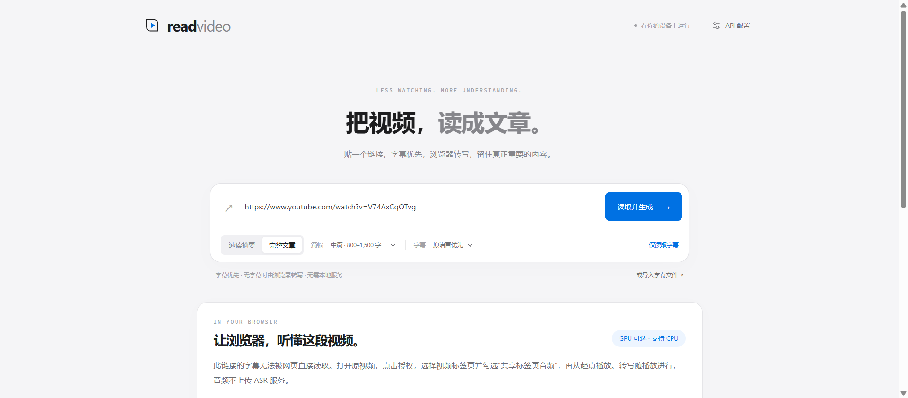
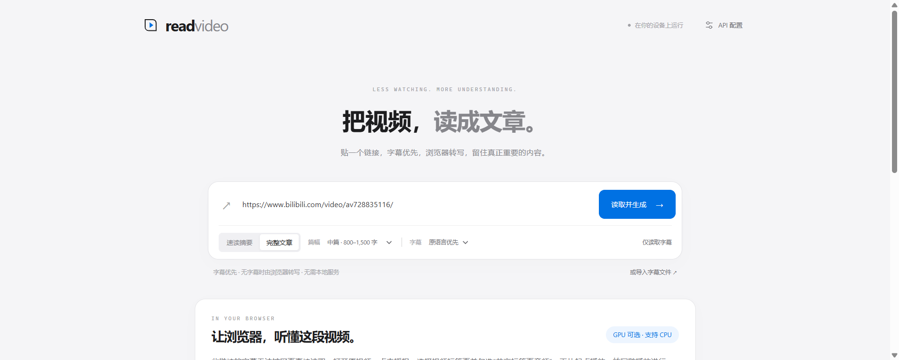
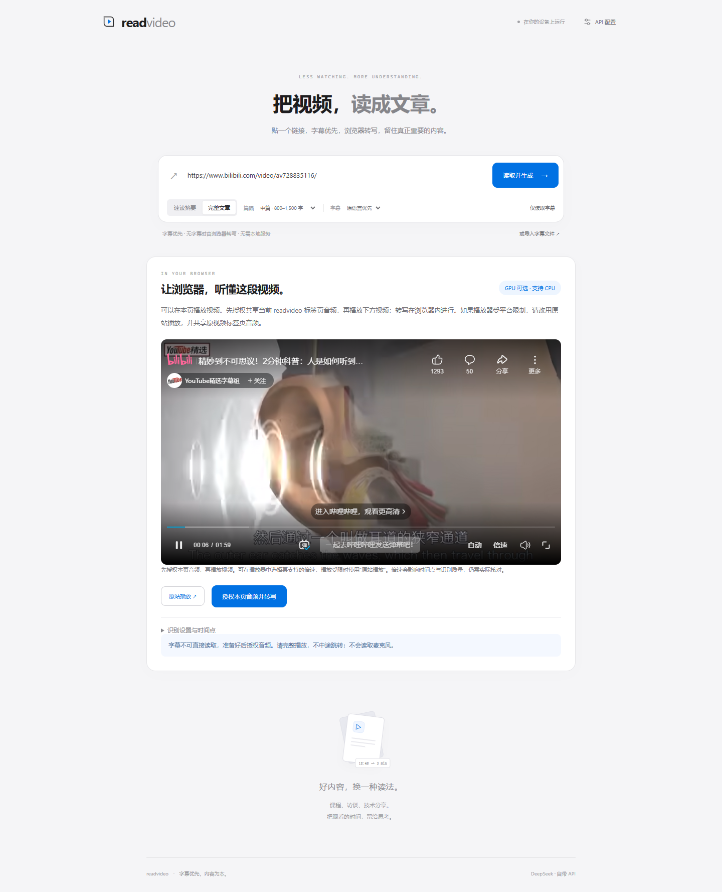
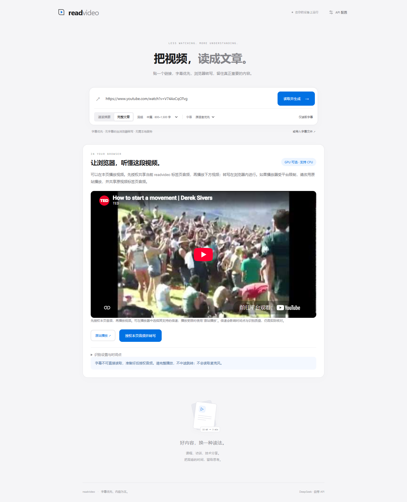

# YouTube / Bilibili 实测记录（进行中）

测试日期：2026-10-24（Asia/Shanghai）。测试对象为公开 GitHub Pages 上的 readvideo v0.3，浏览器为 Windows 上的真实 Chrome 155。未使用 yt-dlp、下载后导入音频、测试模型适配器或自动批准屏幕共享的启动参数替代平台实测。

| 案例 | 实际操作与观察 | 当前结论 |
| --- | --- | --- |
| [YouTube：How to start a movement](https://www.youtube.com/watch?v=V74AxCqOTvg) | 在线上应用粘贴链接并点击“仅读取字幕”；得到 0 条直读字幕，显示音频授权入口。原站播放器已观察到 readyState=4、实际播放状态。 | 字幕直读未成功；授权入口已验证。实际平台音频转写、全文准确率和文章链路尚未验证。 |
| [Bilibili：人是如何听到声音的](https://www.bilibili.com/video/av728835116/) | 在独立的线上应用页粘贴链接并点击“仅读取字幕”；显示音频授权入口，未返回可读字幕。 | 字幕直读未成功；授权入口已验证。播放器可用性、实际音频转写和文章链路尚未验证。 |

这里不能仅凭授权入口出现，就认定平台端到端通过。页面没有获得字幕，也不足以单独区分 CORS、网络、页面格式或平台策略等具体原因。测评期间浏览器控制连接中断过，这属于测评工具问题，不记为 readvideo 或 Bilibili 的失败。

## 待完成的真实授权步骤

### 同页播放器复测（2026-10-24）

开发预览中的真实 Chrome 155 另行打开了官方内嵌播放器，没有视频或模型测试适配器，也未自动批准音频采集：

- Bilibili 案例：视频时长约 118.23 秒，播放器 `readyState=4`，请求播放后计时正常推进；同页播放已观察通过。
- YouTube 案例：内嵌页与缩略图出现，但本轮播放启动在 10 秒内未完成，计时未推进；只记为“未确认播放”，不能据此断言所有用户或所有 YouTube 视频都禁止内嵌。
- 两者都未获得真实音频授权，因此没有把同页播放器测试记为平台音频转写通过。原站播放仍是备用操作。

[原始播放器观察](evaluation-data/embedded-player-results.json)

由用户在浏览器选择目标视频标签页，并勾选共享音频；完整采集指定片段，等待队列结束，保存实际转写。记录采集起点、播放速度、素材时长、首次模型准备、识别耗时与队列等待。没有操作实际授权前，不发布“Bilibili/YouTube 一键转写已通过”的结论。

## 性能边界

标签页共享只提供已经播放的音频。识别更快、增加 Worker 或使用 GPU，都不能获取尚未播放的后半段。现成字幕和可读完整音轨可跳过实时采集；受限平台的采集时间仍受播放进度约束。CPU 识别吞吐与平台视频端到端用时须分别测量。

## 真实 CPU 吞吐测试

在独立真实 Chrome 155 中强制 CPU/WASM，使用 Transformers.js 3.8.1 与 Whisper tiny 多语言量化模型，对同一段公开 JFK 语音连续识别两次。素材长 **11.00 秒**，设备报告 16 个逻辑核心；这不表示模型使用了 16 个线程。

| 指标 | 本次实际观察 |
| --- | --- |
| 模型准备（含本次资源获取与初始化） | 15.27 秒 |
| 第一次识别 | 2.56 秒，约音频时长的 4.30 倍速度 |
| 同一模型实例第二次识别 | 2.08 秒，约音频时长的 5.28 倍速度 |

复现脚本：`node tests/asr-benchmark.mjs`，需要网络访问模型与公开语音样本。[原始计时数据](evaluation-data/cpu-whisper-tiny.json)。模型准备与识别耗时分别统计；没有把首次下载开销藏入“5 倍速度”说法。

这是单个短英语样本的本机观察，不是中文、长视频或所有设备的保证，也不是 YouTube/Bilibili 端到端速度。它说明该机器上推理可以快于播放，当前平台流程的另一个瓶颈仍然是音频获取。

已有真实 CPU/WASM 和浏览器直连 DeepSeek 证据见 [verification.md](verification.md)，它们不能代替本表中的平台音频授权实测。
