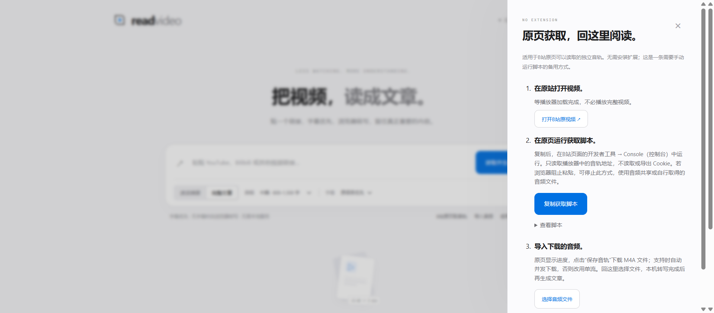
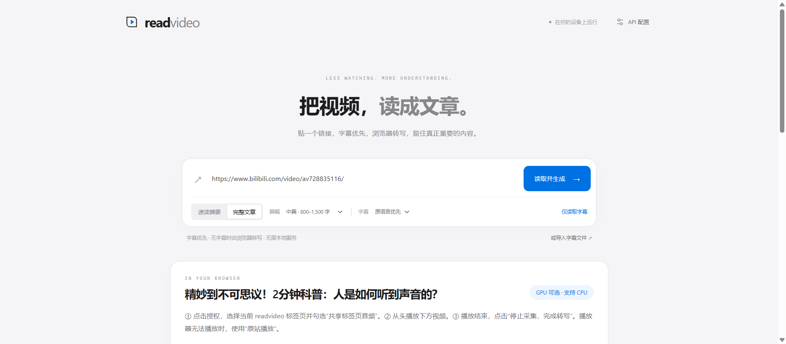

# YouTube / Bilibili 实测记录（进行中）

测试日期：2026-10-24（Asia/Shanghai）。测试对象为公开 GitHub Pages 上的 readvideo v0.3，浏览器为 Windows 上的真实 Chrome 155。未使用 yt-dlp、下载后导入音频、测试模型适配器或自动批准屏幕共享的启动参数替代平台实测。

| 案例 | 实际操作与观察 | 当前结论 |
| --- | --- | --- |
| [YouTube：How to start a movement](https://www.youtube.com/watch?v=V74AxCqOTvg) | 在线上应用粘贴链接并点击“仅读取字幕”；得到 0 条直读字幕，显示音频授权入口。原站播放器已观察到 readyState=4、实际播放状态。 | 字幕直读未成功；授权入口已验证。实际平台音频转写、全文准确率和文章链路尚未验证。 |
| [Bilibili：人是如何听到声音的](https://www.bilibili.com/video/av728835116/) | 在独立的线上应用页粘贴链接并点击“仅读取字幕”；显示音频授权入口，未返回可读字幕。 | 字幕直读未成功；授权入口已验证。播放器可用性、实际音频转写和文章链路尚未验证。 |

这里不能仅凭授权入口出现，就认定平台端到端通过。页面没有获得字幕，也不足以单独区分 CORS、网络、页面格式或平台策略等具体原因。测评期间浏览器控制连接中断过，这属于测评工具问题，不记为 readvideo 或 Bilibili 的失败。

## 待完成的真实授权步骤

### 同页播放器复测（2026-10-24）

开发预览中的真实 Chrome 155 另行打开了官方内嵌播放器，没有视频或模型测试适配器，也未自动批准音频采集：

- Bilibili 案例：视频时长约 118.23 秒，播放器 `readyState=4`，请求播放后计时正常推进；同页播放已观察通过。
- YouTube 案例：内嵌页与缩略图出现，但本轮播放启动在 10 秒内未完成，计时未推进；只记为“未确认播放”，不能据此断言所有用户或所有 YouTube 视频都禁止内嵌。
- 两者都未获得真实音频授权，因此没有把同页播放器测试记为平台音频转写通过。原站播放仍是备用操作。

[原始播放器观察](evaluation-data/embedded-player-results.json)

由用户在浏览器选择目标视频标签页，并勾选共享音频；完整采集指定片段，等待队列结束，保存实际转写。记录采集起点、播放速度、素材时长、首次模型准备、识别耗时与队列等待。没有操作实际授权前，不发布“Bilibili/YouTube 一键转写已通过”的结论。

## 性能边界

### 手动原页脚本：取音轨与本地文件转写（2026-10-24）

用户随后接受在B站原页手动运行代码的路线。这改变了执行来源：获取代码在 `www.bilibili.com` 的页面上下文运行，不是在 readvideo 跨站请求。没有使用扩展、代理或导出 Cookie。

- 本项目自包含脚本在用户真实 Chrome 原页取得 **996,214 字节 M4A 音轨**，分段下载标记为并发；第一次观察获取阶段 **1,325 ms**。页面和播放器元数据已预先加载，这不包含打开原站的耗时；后续有缓存的观察更快。
- 脚本提供明确的“保存音轨”链接。自动化操作此用户 Chrome 后，没有观察到原生下载完成记录；没有将“音轨已在内存”误记为“文件保存成功”。另一个真实 Chrome 使用明确的平台响应适配器，已验证点击保存触发下载，文件字节与组装结果完全一致。这只证明保存控件行为。
- 为验证真实语音，调试工具另取同一公开音轨的参考副本，并校验 SHA-256 与用户浏览器实际取得的字节一致。该参考副本导入 readvideo 实际文件入口，在真实 Chrome **强制 CPU/WASM**、无模型适配器下完成识别：总耗时 **31,814 ms**，包括模型准备、解码与推理；输出 **25 条字幕**。页面显示音频约 1 分 58 秒。
- 没有进行识别准确率评分，也没有在本轮调用大模型生成文章。该英语样本结果不能推广到所有视频、设备或匿名浏览器。

这验证了“原站页面取流”与“本机文件转写”，但还不是用户浏览器中一次完整的“原站运行 → 保存 → 导入 → 文章”连续验收。[计时与校验记录](evaluation-data/bilibili-manual-local.json)。

### 原站音轨与 readvideo 直接读取复测（2026-10-24）

在用户的真实 Chrome 中分析同一B站样本，未安装扩展或修改浏览器安全设置：

- 原站播放器含 3 个 DASH 音轨格式，读取其中一个音轨的前 1,024 字节返回 HTTP 206。该浏览器已有站点会话，不能据此宣称匿名用户全部可用。
- 切换至公开 readvideo 页面，直接 fetch 视频信息、播放地址、字幕接口均失败；仅凭这个错误不能把原因全部归为 CORS。
- 官方 `/x/web-interface/view` 的 JSONP 回调实际成功，返回视频标题、cid 和分P信息；样本公开字幕列表为空。已将该入口接入应用，并在无同源权限的沙箱内运行，隔离 API Key 与配置。
- 播放、字幕及 nav 接口的 JSONP 尝试未成功；不带 Referer 的播放、字幕请求也未成功。辅助的非浏览器匿名请求对播放接口收到 HTTP 403，这项辅助观察不算网页成功。
- 将播放器提供的六个主备音轨候选逐一从 readvideo 请求前 1 KB，全部返回 HTTP 403。另对一个候选比较默认 Referer 策略与 no-referrer，均为 403。没有把错误页内容当成音频。

结论：**本轮证明视频信息存在无插件入口，但没有实现该样本从 readvideo 直取完整音轨。** 这与“原站浏览器能播放”是两个独立的验证项。不会把此结果包装成多线程下载成功，也不据此断言所有视频、节点和未来接口都不可能支持。

[不含 Cookie、签名地址和账号信息的观察记录](evaluation-data/bilibili-browser-direct.json)。

同一用户 Chrome 随后在更新的开发页面实际粘贴该链接并点击“仅读取字幕”：标题正确显示，公开字幕数为 0，回退面板可见，无应用错误，剩余沙箱数量为 0。这是元数据与回退验证，不是完整音轨验证。

标签页共享只提供已经播放的音频。识别更快、增加 Worker 或使用 GPU，都不能获取尚未播放的后半段。现成字幕和可读完整音轨可跳过实时采集；受限平台的采集时间仍受播放进度约束。CPU 识别吞吐与平台视频端到端用时须分别测量。

## 真实 CPU 吞吐测试

在独立真实 Chrome 155 中强制 CPU/WASM，使用 Transformers.js 3.8.1 与 Whisper tiny 多语言量化模型，对同一段公开 JFK 语音连续识别两次。素材长 **11.00 秒**，设备报告 16 个逻辑核心；这不表示模型使用了 16 个线程。

| 指标 | 本次实际观察 |
| --- | --- |
| 模型准备（含本次资源获取与初始化） | 15.27 秒 |
| 第一次识别 | 2.56 秒，约音频时长的 4.30 倍速度 |
| 同一模型实例第二次识别 | 2.08 秒，约音频时长的 5.28 倍速度 |

复现脚本：`node tests/asr-benchmark.mjs`，需要网络访问模型与公开语音样本。[原始计时数据](evaluation-data/cpu-whisper-tiny.json)。模型准备与识别耗时分别统计；没有把首次下载开销藏入“5 倍速度”说法。

这是单个短英语样本的本机观察，不是中文、长视频或所有设备的保证，也不是 YouTube/Bilibili 端到端速度。它说明该机器上推理可以快于播放，当前平台流程的另一个瓶颈仍然是音频获取。

已有真实 CPU/WASM 和浏览器直连 DeepSeek 证据见 [verification.md](verification.md)，它们不能代替本表中的平台音频授权实测。
